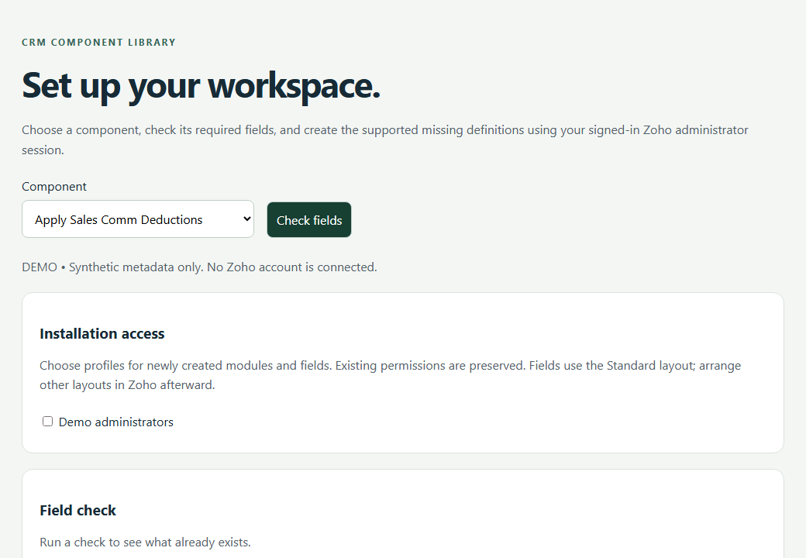

# Zoho CRM Automations

Commercial automation components for BOM, scope, commissions, onboarding, agreement delivery, signed role events and project execution.

**Commercial product showcase.** This repository supplies product information and fictional demonstration media only. No Deluge source, widget installers, free beta packages or software license are publicly distributed.

## Schema setup tour

The demonstration uses fictional metadata. Schema Setup can recognize existing compatible fields, identify manual work and provision supported missing definitions after explicit administrator review. It does not install the entire CRM organization or certify functions and workflows.

## Library

<table>
<tr>
<td width="50%" valign="top">
<strong>Bill of materials</strong>
<ul>
<li><strong>Normalize Deal BOM Item.</strong> Sets a blank line to Active, a cost status from the unit-cost snapshot, and the extended cost.</li>
<li><strong>Sync Deal BOM Scope.</strong> Writes the active lines' mapped packages onto the deal.</li>
<li><strong>Sync Deal BOM Summaries.</strong> Rolls addon, brand, and cost buckets from the BOM onto the deal.</li>
<li><strong>Apply Service Addon Default Costs.</strong> Writes a complete lead street address into Company.</li>
</ul>
<strong>Scheduling and Projects</strong>
<ul>
<li><strong>Copy Deal Service Address.</strong> Copies the contact mailing address onto an empty deal service address.</li>
<li><strong>sync_appointment_deal_context.</strong> Copies the deal contact onto the appointment, and the account when one is present.</li>
<li><strong>Company Projects Executor.</strong> Standalone. Calls Zoho Projects after the regional API base URL is set.</li>
</ul>
</td>
<td width="50%" valign="top">
<strong>Commissions</strong>
<ul>
<li><strong>Apply Sales Comm Deductions.</strong> Sets Charge to Sales Comm on active BOM lines when the deal's deduction text matches the line.</li>
<li><strong>Calculate Deal Solar Commission.</strong> Freezes the agent redline and writes the solar price-per-watt spread when the deal includes Solar.</li>
<li><strong>Commission Reconciliation Core.</strong> Writes deduction charges from active BOM lines and the solar pool fields.</li>
<li><strong>Finalize Commission Rollup.</strong> Writes the solar charge total and net pool, and stops on a protected commission status.</li>
<li><strong>Non Solar Commission Core.</strong> Clears the solar charge fields and blocks the non-solar engine when the deal contains Solar.</li>
<li><strong>Non Solar Commission Allocator.</strong> Voids open commissions when non-solar prerequisites fail.</li>
<li><strong>Non Solar Commission Pipeline.</strong> Runs the non-solar core, then the allocator.</li>
<li><strong>Reconcile Sales Commissions.</strong> Loads the selling agent and group, and locks a protected commission status.</li>
</ul>
<strong>Onboarding and agreements</strong>
<ul>
<li><strong>Approve Sales Intake.</strong> Button. Creates an inactive Sales Agent from a Sales Agent intake that has a name and email and is not already processed.</li>
<li><strong>Send Sales Agreement API.</strong> Button. Assembles the agreement fields after the agent id, name, and email are present.</li>
<li><strong>Company Signed Role Event Sender.</strong> Posts a signed reconcile or delete event for a sales agent or sales group member.</li>
</ul>
</td>
</tr>
</table>

## Commercial deployment

Licensed automation source/packages and installation scope are supplied privately. The customer's authorized Zoho administrator deploys the supplied Deluge functions inside Zoho CRM, configures their arguments and native workflow/button bindings, and authorizes required customer-managed connections. Any companion widget uses Zoho internal hosting.

WordPress integrations run server-side on the customer's live WordPress host, using agreed HTTPS callbacks, OAuth scopes, mappings and signed-event contracts. Widget upload does not establish synchronization on its own.

Current components remain under validation. Account-specific schema, calculations, permissions, external services and end-to-end business results must be accepted before commercial production activation. This page is not a free beta offer or a statement of general availability.

[Discuss a commercial implementation](https://github.com/RawPowered/Zoho-CRM-Automations/issues/new?template=commercial-inquiry.yml) · [Deployment model](DEPLOYMENT.md) · [Widget tours](https://github.com/RawPowered/Zoho-CRM-Widgets)
